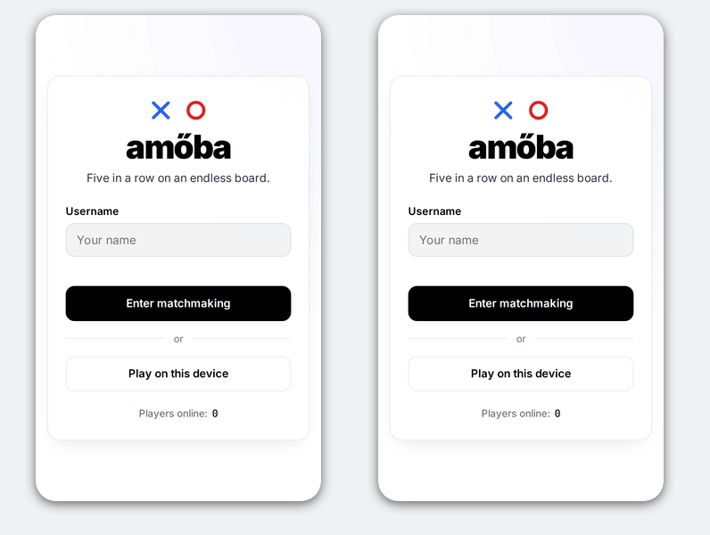

# amőba

Online five-in-a-row on an infinite board. *Amőba* is the Hungarian name for
the game also known as gomoku. The code was written with AI under my
direction.



[](LICENSE)


## Features

- **Online matchmaking.** Pick a username and you're paired with the next
  player waiting. The home screen shows how many players are online. If no
  one turns up within 5 seconds, you're offered a game against Amőbot.
- **Play with friends.** Open a room and send its link (`/r/<code>`) to up
  to 3 friends; the host starts the game once at least 2 players are in.
  With more than two, the players get ✕, ◯, a green △ and an amber □, and a
  player who runs out of time or leaves drops out: their marks stay on the
  board and the last player left wins. After each game everyone goes back to
  the room for the next one. Friends who open the link during a game take a
  free seat and play in the next one.
- **Amőbot.** A computer opponent that runs in the browser, so it works
  offline too, with no turn clock. It blocks and finishes fours and open
  threes, but looks only one move ahead, so a double threat beats it.
- **Infinite board.** Pan and pinch-zoom freely. Blue ✕ always moves first,
  and five or more in a row (horizontal, vertical or diagonal) wins. Each
  mark goes within 5 cells of another, so the game stays in one place.
- **Turn clock.** Each move has 30 seconds. If you run out, you lose.
- **Mobile-first.** On touch screens, the first tap shows a dashed preview and
  a second tap places the mark, so you don't misplace moves on a phone.
- **Installable.** It's a PWA: add it to the home screen and it opens like an
  app, offline too (same-device and Amőbot games). Shared links show a preview
  card (Open Graph).
- **Same-device play.** "Same device" starts a local game for two
  people sharing one screen. It needs no username, no timer and no server.
- **Rematches and reconnects.** A dropped connection can rejoin with its
  session token and carry on.
- **Clean usernames.** Names are 1–16 characters and are checked against an
  English and Hungarian bad-word list.

## Quick start

Everything runs in Docker. You don't need Go or Node installed.

```bash
docker compose -f docker-compose.dev.yml up --build --watch
```

Open http://localhost:8080. To play against yourself, open a second browser
profile or a private window, because tabs in the same browser share an
identity. Client changes reload in the browser instantly, and server changes
rebuild the Go container.

To test from a phone on the same network, set `HTTP_BIND=0.0.0.0` in `.env`
(copy it from `.env.example`) and open `http://<your-computer-ip>:8080`.

Run the server tests with:

```bash
docker build --target test server
```

## How it works

```
Browser ─► [webserver proxy :80/:443] ─► [web: Caddy, automatic HTTPS] ─┬─ static site
                                                                        └─ /ws ─► [server: Go :8080]
```

| Directory | What |
|-----------|------|
| `server/` | Go WebSocket server: sessions, matchmaking queue, rooms for friends, game rules, turn clock. All state is in memory, and the server is authoritative. |
| `client/` | Plain `index.html` + CSS + TypeScript (canvas game), bundled by esbuild (`build.mjs`), plus the service worker (`sw.js`). Amőbot lives in `src/scripts/bot.ts`; `npm test` runs its tests. `tsc` only type-checks. Also holds the `Caddyfile`; the production image is Caddy serving the build. |
| `client/art/` | Sources for the app icons and the link preview image. `client/art/render.sh` renders them into `client/public/` with a headless Chrome, Brave or Chromium. |
| `docs/protocol.md` | The WebSocket message protocol. |

The bad-word list is plain text in `server/internal/hub/badwords.txt`. Add
words there and rebuild the server.

## Deploying

Production runs behind a shared TCP proxy from
[webserver-proxy](https://github.com/gmiszori/webserver-proxy), which owns
host ports 80 and 443 so several sites can share one server. The proxy passes
TLS through untouched, and this repo's Caddy holds the certificate.

1. Point your domain's DNS `A` record (and `AAAA`, if the server has IPv6) at
   the server.
2. Open inbound TCP 80 and 443, and start the webserver proxy with
   `AMOEBA_DOMAIN` set to your domain.
3. On the server:
   ```bash
   git clone https://github.com/gmiszori/amoeba && cd amoeba
   cp .env.example .env   # set DOMAIN=your.domain
   docker compose up --build -d
   ```

Caddy requests a Let's Encrypt certificate on first start (check with
`docker compose logs web`) and renews it automatically. Certificates live in
the `caddy_data` volume, so they survive rebuilds. To update, run
`git pull && docker compose up --build -d`. Restarting the server ends
running games, because game state is kept in memory.

If the domain's DNS is on Cloudflare, use "DNS only" (grey cloud). With the
orange-cloud proxy every player would appear to come from a Cloudflare
address, and they would all share one per-IP connection limit.

To run the production stack locally, start the webserver proxy with
`PUBLIC_BIND_IP=127.0.0.1` and `AMOEBA_DOMAIN=localhost`, set
`DOMAIN=localhost` in this repo's `.env`, and run `docker compose up --build`.
Then open https://localhost. The certificate is self-signed, so the browser
warns once.

### Configuration (`.env`)

| Variable | Default | |
|----------|---------|--|
| `DOMAIN` | `localhost` | Domain Caddy serves and gets a certificate for. Must match `AMOEBA_DOMAIN` in the webserver proxy. |
| `TURN_SECONDS` | `30` | Seconds per move. |
| `ALLOWED_ORIGINS` | – | Extra WebSocket origins, only needed if the page is served from a different host. |
| `HTTP_BIND` / `HTTP_PORT` | `127.0.0.1` / `8080` | Dev stack only: where its Caddy is published. |

## Security

- **Server-authoritative.** The server decides every move, the clock and the
  winner, so clients can't cheat by editing the page. Session tokens are
  128-bit random values.
- **Limits.** WebSockets only accept the site's own origin. Messages are
  capped at 1 KB and 10 per second per connection, and connections (50 per IP,
  5000 total), sessions and moves per game are limited.
- **Headers.** Caddy sends a strict Content-Security-Policy (only the site's
  own scripts, styles and WebSocket), HSTS, and headers that stop other sites
  from framing the game.
- **HTTPS everywhere.** Caddy redirects HTTP to HTTPS and manages
  certificates.
- **Hardened containers.** Every container runs as a non-root user with a
  read-only filesystem, no Linux capabilities and memory/process caps. Nothing
  is published on the host: Caddy is reachable only through the webserver
  proxy, and the game server only through Caddy.
- **Trusted proxy only.** Caddy trusts the client address in a PROXY header
  only from the proxy's fixed address (`172.31.250.2`), so other containers
  can't fake one.

When deploying, don't publish the server's port 8080, because its per-IP
limit trusts the `X-Forwarded-For` header that Caddy sets. Rebuild now and
then (`docker compose build --pull`) to pick up base-image security fixes.

## License

[MIT](LICENSE)
